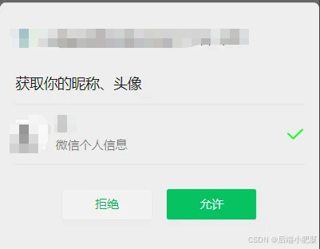
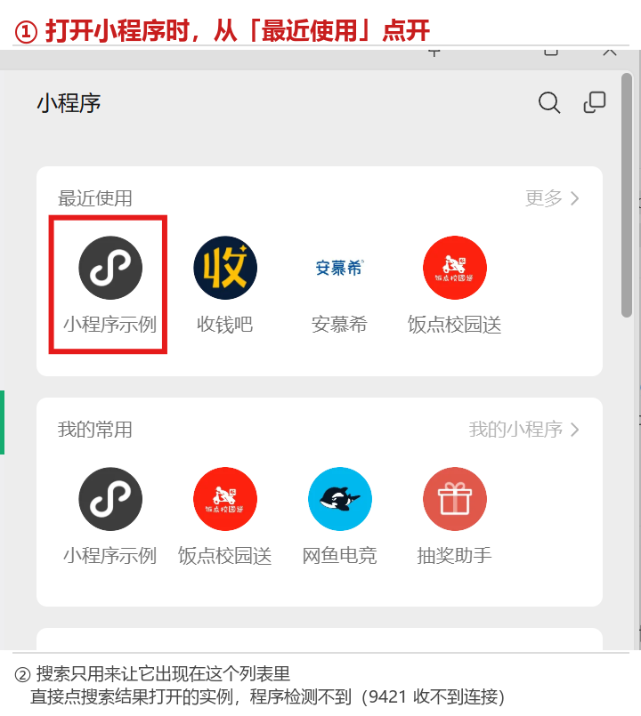

# 微助教自动签到 · 从零开始使用教程

> 这份教程写给第一次使用的同学。不需要懂命令行，也不需要懂代码，按顺序做完第 1～5 步即可。  
> 每一步都写了「做完应该看到什么」，看到不一样的现象，就到最后的「常见问题」里按现象查找。  
> 遇到问题先看界面上的那行字，它已经把当前在做什么说清楚了。

---

## 开始前：先确认这几件事

| 要检查的东西  | 要求                    | 怎么确认                                                                                      |
| ------- | --------------------- | ----------------------------------------------------------------------------------------- |
| 电脑系统    | Windows 64 位          | 设置 → 系统 → 关于，看「系统类型」                                                                      |
| 微信 PC 版 | 已安装、能正常登录             | 双击桌面微信图标                                                                                  |
| 网络      | 第一次运行需要联网             | 能打开网页即可                                                                                   |
| 程序文件    | `wxsign-portable.exe` | 从 [Release 页面](https://github.com/qyr0721/weizhujiao-autosign-pc-hook/releases/latest) 下载 |
| Python  | **不需要安装**             | 程序已内嵌运行环境                                                                                 |

两点说明：

- 自 **v1.6.0** 起，Release 只提供这一个 exe，不再提供集成版压缩包。exe 第一次运行会自己下载所需组件，之后就不需要网络了。
- **不需要为了这个程序去降级微信或关闭自动更新**。微信更新后程序会自动重新探测所需偏移，见常见问题 E1。

建议把 exe 单独放在一个文件夹里（例如 `D:\wxsign\`），因为程序会在它旁边生成配置和日志，放桌面容易弄乱。

---

## 第 1 步：启动并登录微信，之后一直别关

1. 双击打开微信 PC 版，用手机扫码登录。
2. 确认电脑右下角托盘里有微信图标。
3. 接下来的整个使用过程中，**微信必须一直开着**。窗口可以最小化，但程序不能退出。

为什么要这样：程序要从微信内置的浏览器里取得签到凭证，微信没运行，后面每一步都做不下去。

**怎么判断做对了**：程序界面上「微信 x.x.x.x · WMPF xxxxx」这一行能显示出版本号，且「自检」显示「正常」。如果显示「微信未运行」，回到这一步重新登录。

---

## 第 2 步：首次使用，手动授权一次（这一生只做一次）

> **⚠️ 首次使用必须手动授权一次**
>
> 程序需要你先在微信里手动走一遍签到入口，让微信客户端完成一次 OAuth 授权。  
> 有了这次授权，之后凭证过期时程序才能在后台自动接管、自动续期。
>
> **操作步骤（仅首次需要）：**
>
> 1. 在微信里打开「微助教服务号」，找到老师发的签到通知（或任意班级通知）
> 2. **右键点击通知卡片**（或点击「查看详情」），在弹出的菜单中点击 **「签到(C)」**
> 3. 接下来会跳转到微信授权页面，**点击「确认授权」**（或「允许」）
> 4. 授权完成后会进入签到页面，至此首次授权完成
>
> 之后运行本程序即可全自动签到。若长时间后凭证失效导致签到中断，**重新执行上述步骤一次**即可恢复。

上面第 3 步会看到的授权页面长这样：确认「微信个人信息」已勾选，然后点右边绿色的**「允许」**（不同版本里这个按钮也可能写作「确认授权」）。



说人话就是：**先让微信自己认一次门，程序以后才能替你进门。** 没有这一步，程序拿不到任何有效凭证，会一直卡在「等待取号」，怎么等都没用。

**怎么判断做对了**：第 4 小步能看到微助教的签到页面，就说明授权成功。看到页面后可以直接把它关掉，不用停留在那里。

三个提醒：

- 做完不需要重启程序，程序会自动继续往下走。
- **不要没事反复授权**。每做一次新的授权，都会让程序正在用的旧凭证失效；程序只在发现凭证失效（HTTP 401）时才自动换号，频繁手动授权只会给自己添乱。
- 如果换了电脑、重装了微信、或换了微信账号，这一步要重新做一次。

---

## 第 3 步：运行程序，认识面板

1. 双击 `wxsign-portable.exe`，会弹出一个终端窗口，程序在这里显示状态。**窗口保持开着**（可以最小化，但别点 × 关掉），程序就在这个窗口里值守。
2. **第一次运行会联网部署组件**（Node 运行时、WMPFDebugger、frida 等，合计约一两百 MB），面板会显示「准备部署运行环境…」。这一步可能要几分钟，请耐心等，**不要关窗口、不要在这期间打开小程序**。
3. 部署完成后，会进入这样的面板。下面的数字（版本、WMPF、日志文件名、号）每台机器都不一样，属正常：

```
╭──────────────────────────────────────────────────────────╮
│  微助教自动签到  v1.8                                     │
│  by Hikari                                               │
│  github.com/qyr0721/weizhujiao-autosign-pc-hook          │
╰──────────────────────────────────────────────────────────╯

  ●  微信 4.1.15.56   ·   WMPF 25819
  ●  自检  正常

  ·─────────────────────────────────────

  ▌监视中 · 号 4026a8fb

    通道已建立，无需再操作
    小程序可以缩到后台或最小化

  ·─────────────────────────────────────
  签到  ✓ 12:34:56  签到成功
  ·─────────────────────────────────────

  日志  logs\wxsign-20261105-2100.log
  按 T 打开使用教程   ·   Ctrl+C 退出，不影响正在运行的小程序
```

面板上每一行的意思：

| 面板上显示                           | 代表什么                       | 需要你做什么           |
| ------------------------------- | -------------------------- | ---------------- |
| `微助教自动签到 v1.8`                  | 程序版本                       | 不用管              |
| `● 微信 4.1.15.56 · WMPF 25819`   | 检测到的实际版本；和内置的 25799 不一样也正常 | 不用管              |
| `● 自检 正常`（绿点）                    | 环境就绪                       | 变红点「异常」时看常见问题 A 组 |
| `⚠ 首次使用，需要先手动授权一次`              | 第 2 步还没做                   | 回去做第 2 步         |
| `正在注入调试 hook…（约 10 秒，此期间勿开小程序）` | 正在准备通道                     | 等，先别开小程序         |
| `调试 hook 已注入，现在可以打开小程序`         | 通道准备好了                     | 可以进第 4 步了        |
| `等待小程序连接`                       | 小程序还没连上                    | 按第 4 步打开小程序      |
| `正在取号…（不要关闭小程序）`                | 正在后台取得凭证                   | 别关小程序，等几秒        |
| `换号成功 · 号 xxxxxxxx`             | 拿到新凭证了                     | 不用管，会自动进入值守      |
| **`监视中 · 号 xxxxxxxx`**          | **一切就绪，正在每 5 秒检查一次签到**     | **不用再做任何事**      |
| `通道已建立，无需再操作` / `小程序可以缩到后台或最小化` | 通道已稳定                      | 可以把小程序和窗口最小化     |
| `签到 ✓ 12:34:56 签到成功`（绿勾）         | 刚刚自动签上了                    | 不用管              |
| `签到 · —`                         | 现在还没有进行中的签到                | 不用管，正常           |
| `日志 logs\wxsign-....log`        | 出问题时查这个文件                  | 见常见问题            |
| **按 T 打开使用教程**                  | 完整图文教程就在程序里                | 随时按 T             |
| `Ctrl+C 退出，不影响正在运行的小程序`         | 正确的退出方式                    | 见第 6 步           |

### 最终要等到的样子

**当动作行（`▌` 开头那行）变成「监视中 · 号 xxxxxxxx」（后面是 8 位字母数字），并且下面两行提示变成「通道已建立，无需再操作」「小程序可以缩到后台或最小化」时，就全部设置完成了。**

这三句话同时出现，表示：凭证已取得、调试通道已连通、程序正在后台值守。此后老师一发起签到，程序会在约 5 秒内自动提交，你不需要再点任何东西。

如果面板还停在「等待小程序连接」，属于正常中间状态，继续做第 4 步即可。

> **教程就在程序里**：面板显示期间随时按 `T` 键，会用系统默认的 Markdown 阅读器 / 浏览器打开完整图文教程（含所有配图），完全离线，不需要去 GitHub 找。

---

## 第 4 步：用正确的方式打开小程序（最容易做错的一步）

**顺序不能反**：一定要先启动程序（第 3 步），等界面出现「调试 hook 已注入，现在可以打开小程序」，再打开小程序。如果小程序先开着、程序后启动，连接不会成功。

原因在于：调试通道只在**小程序启动的那一瞬间**建立，而且断开之后不会自动重连。所以打开方式必须讲究。

### 打开顺序：先搜到它，再从「最近使用」点开



```
① 在微信顶部搜索框搜到目标小程序
   —— 这一步只是让它出现在「最近使用」列表里，不是让你在这里打开
② 不要点搜索结果本身
③ 回到「小程序」面板 →「最近使用」（或「我的常用」）→ 点那个图标打开
```

**为什么必须这样**：从搜索结果直接打开的小程序走的是另一条加载路径，不经过被 hook 的 `OnLoadStart`，因此不会被写成调试态，9421 端口收不到连接，程序会一直停在「等待小程序连接」，看起来像「检测不到」。

还有几条一定要记住：

- 已经用搜索方式打开的实例**不会自愈**——必须先把它关掉，再按上面的顺序重新打开一次。
- 微信顶部的搜索框、「搜一搜」都算搜索，从那里点开都不算数。
- 建议用微信官方的「小程序示例」：它默认就在「最近使用」里，体积小、启动快、长期可用，拿它来「点火」最省事。
- 打开哪个小程序都行，不需要是微助教的小程序，只要能连上调试通道即可。

> 微信文章页与公众号页面不属于小程序，不会触发 WMPF 运行时初始化，无法替代。

**怎么判断做对了**：回到程序窗口，动作行从「等待小程序连接」变成「监视中 · 号 xxxxxxxx」，提示行变成「通道已建立，无需再操作」。如果没变，按常见问题 C1 的顺序逐条排查。

---

## 第 5 步：确认签到真的生效

1. 老师在微助教发起签到后，程序会在约 5 秒内发现并自动提交。
2. 界面的「签到」一行会变成 `签到 12:34:56 签到成功`；如果之前已经签过，会显示 `已签到（之前签过）`，这也是正常的。
3. 想再确认一次，可以打开微信里的微助教学生端看签到状态，或打开界面上给出的日志文件，搜「签到成功」。
4. 「签到 —」表示当前没有进行中的签到任务，不是故障。

到此为止，设置全部完成。之后只要保持微信、程序、小程序三者都开着，就能一直自动签到。

---

## 第 6 步：日常使用与正确退出

- **可以**：把程序窗口、微信窗口、小程序都最小化，小程序缩到后台。
- **不可以**：关掉微信、关掉小程序、结束后台的 node 进程、直接点窗口 × 强关程序。
- **退出方式**：回到程序窗口按 `Ctrl+C`。退出后调试代理仍在运行，这是故意的：代理一断，微信会立刻把以调试态启动的小程序关掉。下次直接再运行程序即可，不必重新做第 2 步。
- 想连代理一起彻底关闭，才需要手动结束对应的 node 进程，见常见问题 F5。

---

## 第 7 步（可选）：需要 GPS 签到时填坐标

只有老师发起「位置签到 / GPS 签到」时才用得上；普通签到**不需要**填。

1. 找到程序所在目录下的 `signer\config.json`。第一次运行程序会自动生成，找不到就再运行一次程序。
2. 用记事本打开，改成下面的样子：

```json
{
  "poll": 5,
  "lat": 30.123456,
  "lon": 120.123456,
  "jitter_deg": 0.00003
}
```

| 字段           | 填什么                          |
| ------------ | ---------------------------- |
| `lat`        | 纬度，数值较小，约 20～50              |
| `lon`        | 经度，数值较大，约 75～135             |
| `poll`       | 检查签到的间隔秒数，默认 5，一般不用改         |
| `jitter_deg` | 坐标抖动幅度，默认约 ±1.6 米，避免每次上报完全相同 |

1. 取坐标：打开[高德坐标拾取器](https://gaode.com/ssr/coordinate-picker)，搜索上课的教学楼，点地图上的位置，复制经纬度。**坐标系用 GCJ-02**（腾讯、高德都是）；百度地图给的是 BD-09，会差几百米，需要先转换。
2. 小数保留 6 位即可，`lat` 和 `lon` 不要写反。
3. **保存后必须重启程序**，配置只在启动时读取一次。

说明：程序对上报的坐标不做真实性校验，留 `null` 也能提交。但如果课程确实对位置有要求，请填写真实坐标并自行遵守课程规定。

---

# 常见问题（Q\&A）

## A. 启动和自检

**A1. 自检显示「微信未运行」**  
回到第 1 步：启动并登录微信 PC 版，确认托盘图标在，然后重启本程序。

**A2. 自检显示「缺 WMPF 运行时」**  
微信还没初始化小程序运行时。随便打开一次任意小程序（按第 4 步的方式），让它生成 WMPF 目录，然后重启本程序。

**A3. 显示的 WMPF 版本和 25799 不一样，是不是不能用？**  
能用。自 v1.6.0 起，版本只是配置文件的名字，不再是可运行的门槛。首次遇到新版本时界面会显示「检测到新版本，正在探测 hook 偏移…」，多等约 10 秒即可，不需要降级微信。

**A4. 第一次运行一直停在「准备部署运行环境…」**  
正在联网下载 Node 便携包和 frida 预编译绑定，体积较大，慢的时候要几分钟。保持网络畅通、不要关窗口。若中途失败，重新运行程序会接着部署，不会重复下载已完成的部分。

**A5. exe 被杀毒软件拦截或报毒**  
PyInstaller 打包的程序常被误报。在杀毒软件里放行，或改用源码方式运行（见 F7）。

**A6. 提示「缺 Node」「缺 WMPFDebugger」，自动部署也失败**  
先检查网络（公司/校园网可能拦截 GitHub 与 npm）。也可以复用本机已有组件：新建两个环境变量 `WZ_NODE`（node.exe 完整路径）和 `WZ_WMPF_DIR`（WMPFDebugger 目录），然后重启程序。

**A7. 端口 9421 / 62000 被占用，或者提示代理已经在跑**  
程序会复用已在运行的代理，不会重复注入。不要同时开两个程序实例；如果状态混乱，结束 node 进程后重新运行一次程序。

**A8. 不小心把程序窗口关掉了 / 窗口一闪而过**  
重新双击 exe 即可，调试代理一般还在运行，程序会自动复用（见 A7）。若窗口一闪而过，多半是缺运行库或被杀软拦截，先在命令行里运行 `wxsign-portable.exe --plain` 看报错信息。

## B. 授权与凭证

**B1. 一直显示「等待手动授权」或「等待取号」**  
第 2 步没做，或做的时候没走到签到页面。严格按第 2 步的四个小步重做一次，完成后不必重启程序。

**B2. 一直显示「正在取号…」或「取号失败，稍后重试」**  
依次检查：小程序是否按第 4 步连上（界面有没有「通道已建立」）、微信是否仍登录、第 2 步的授权会话是否还在。仍不行就重做一次第 2 步。

**B3. 号码不停变、每隔几秒就换一次**  
通常是微信里没有可复用的会话，或在别处又登录/授权把会话顶掉了。重做一次第 2 步，并避免同时在手机和电脑上反复授权。

**B4. 出现「号已失效」或日志里有 401**  
属正常自愈流程：程序发现凭证失效后会立即重新取号，一般几秒内自动恢复，不用管。若持续失败，重做第 2 步。

**B5. 手动授权会不会把之前的号弄失效？**  
会。新授权会顶掉旧凭证。所以只在首次使用、或自动取号长期失败时才做，不要定期手动授权。

**B6. 换电脑、重装微信、换微信账号后要重做吗？**  
要，重新做一次第 2 步。

## C. 通道与小程序

**C1. 一直显示「等待小程序连接」（最常见）**  
按顺序逐条排查，每做完一条就回来看界面：

1. 确认是**从「最近使用」点开**的，不是点搜索结果；搜索只负责让小程序进入列表。
2. 关掉之前用搜索方式打开的那个实例，再按「搜索 → 回最近使用点开」重来一遍。搜索打开的实例不会自愈。
3. 确认顺序：先启动本程序（等界面出现「调试 hook 已注入」），再打开小程序。反了不会成功。
4. 换一个更轻的小程序，例如「小程序示例」。它能连上就说明是原来那个小程序的加载路径问题。
5. 看日志里有没有这两行：`[proxy] [frida] script loaded ... you can now open any miniapps`（hook 已就绪）、`[proxy] [miniapp] miniapp client connected`（小程序已连上）。只有第一行、没有第二行，就是小程序没走被 hook 的启动路径。

**C2. 我用搜索打开过了，能自己恢复吗？**  
不能。必须先彻底关掉那个实例，再按第 4 步重新打开。

**C3. 小程序能最小化吗？能锁屏吗？**  
能最小化、缩到后台，但不能关闭。电脑休眠/断网会让通道中断，上课期间建议不要休眠。

**C4. 关掉程序后，小程序也被关了**  
说明调试代理被一起关掉了。正确做法是回到程序窗口按 `Ctrl+C` 退出，**不要**去任务管理器结束 node 进程。详见 F5。

**C5. 打开微信文章页或公众号页面可以代替小程序吗？**  
不可以，它们不属于小程序，不会初始化 WMPF 运行时，9421 收不到连接。

**C6. 代理重启过之后要重新打开小程序吗？**  
要。代理重启会断开 9421 上的旧连接，且不会自动重连，重新按第 4 步打开一次即可。

## D. 签到结果

**D1. 「签到 —」一直不变，是不是没在工作？**  
界面显示「监视中 · 号 xxxxxxxx」就说明程序正在每 5 秒查一次，只是老师还没发起签到。不用做任何操作。

**D2. 显示「签到失败」**  
打开日志看 HTTP 状态码：网络类错误会自动重试；若伴随 401，属于凭证问题，看 B4；若持续失败且界面有「查询失败」，检查网络与微助教服务是否可用。

**D3. 显示「已签到（之前签过）」**  
幂等提示，说明这次签到之前已经成功提交过，不会重复提交，正常。

**D4. 会不会重复签到？**  
不会。同一个 `signId` 只提交一次，`repeat sign in`、`已经签到`、错误码 305 都会被当作已签到处理。

**D5. 怎么确认真的签上了？**  
看界面「签到成功」一行、微助教学生端的签到状态，或日志里的 `signRank` 与「签到成功」。

**D6. GPS 签到没带坐标 / 位置不对**  
检查 `signer\config.json` 里 `lat`/`lon` 是否填了、有没有写反、坐标系是不是 GCJ-02，改完必须重启程序。详见第 7 步。

**D7. 有上课时段限制吗？凌晨会不会不工作？**  
没有。轮询间隔固定为配置里的 `poll`（默认 5 秒），不受本地时间影响，任何时刻发现签到都会提交。

## E. 微信更新、偏移与安全

**E1. 微信自动更新了，程序还能用吗？**  
能。自 v1.6.0 起，程序按当前 WMPF 版本与 `flue.dll` 指纹自动探测偏移并写回，不需要降级微信、不需要手工重扫。首次遇到新版本会在启动时多花约 10 秒。

**E2. 界面显示「偏移探测失败，改用临时模式」**  
不影响使用：程序会退回上游自带的临时探测模式，只是每次启动多等约 10 秒。想手动修复，可在源码目录执行 `python offsets.py --detect`。

**E3. 界面显示「偏移已更新，请重新打开小程序」**  
运行中发生偏移重探时，调试代理会短暂重启，9421 断开，小程序可能被微信关掉。按第 4 步重新打开一次小程序即可；启动阶段的探测则完全无感。

**E4. 还需要关闭微信自动更新吗？**  
不再必需。锁版本现在只剩「省掉一次约 10 秒的探测」这点好处。

**E5. 集成版（wxsign-integrated.zip）哪里去了？**  
自 v1.6.0 起不再提供。便携版首次运行联网部署完组件后，日常运行同样完全离线，体验一致。已下载的旧集成版仍可用，但不再更新。

**E6. 有没有账号或合规风险？**  
有。程序通过修改微信运行时内存打通调试通道，属于绕过客户端自身限制的行为，可能违反微信软件许可协议并存在账号风险；也可能违反所在学校或机构的规定。本项目仅供学习与技术研究使用，请自行评估并承担风险。

**E7. 出问题要反馈，该提供什么？**  
附上程序目录下 `logs\wxsign-日期.log` 的完整内容，并说明界面当时显示的是哪一行文字、微信版本与 WMPF 版本号。注意日志里可能含凭证信息，公开前请先检查。

## F. 其它


**F1. 找不到 `config.json`**  
它在程序所在目录的 `signer` 子目录里，文件名固定为 `config.json`。第一次运行程序会自动生成模板；也可以直接在程序根目录放一个 `config.json`，程序同样能识别。

**F2. 改了配置没生效**  
配置只在启动时读取一次，保存后重启程序。

**F3. 能同时开两个微信 / 两个程序实例吗？**  
不支持。一台机器只有一套调试通道（9421 / 62000），重复启动会造成冲突。

**F4. 窗口中文显示乱码**  
程序会自动把控制台切到 UTF-8。若在你的终端里仍然乱码，可用 `wxsign-portable.exe --plain` 以纯文本模式运行。

**F5. 按了 Ctrl+C 退出，代理怎么还在？**  
这是有意设计：代理停掉，微信会立即关闭以调试态启动的小程序。若确实要彻底关闭，在任务管理器里结束对应的 `node.exe` 进程，或手动关闭调试代理；之后需要重新按第 4 步打开小程序。

**F6. 想只检查状态、不常驻运行**  
用 `wxsign-portable.exe --check`（或源码 `python wizard.py --check`）只打印环境自检结果后退出。想看通道与凭证详情，用 `python run.py --check`。

**F7. 想用源码运行而不是 exe**

```bash
git clone https://github.com/qyr0721/weizhujiao-autosign-pc-hook.git
cd weizhujiao-autosign-pc-hook
pip install websockets
python run.py --check
python wizard.py    # 或 start.bat
```

需要 Python 3.10 以上，其余依赖与 exe 相同。

**F8. 这个程序会模拟鼠标点击或截屏吗？**  
不会。全过程通过接口轮询与提交完成，不需要你点「签到」，也不需要屏幕保持亮着。
